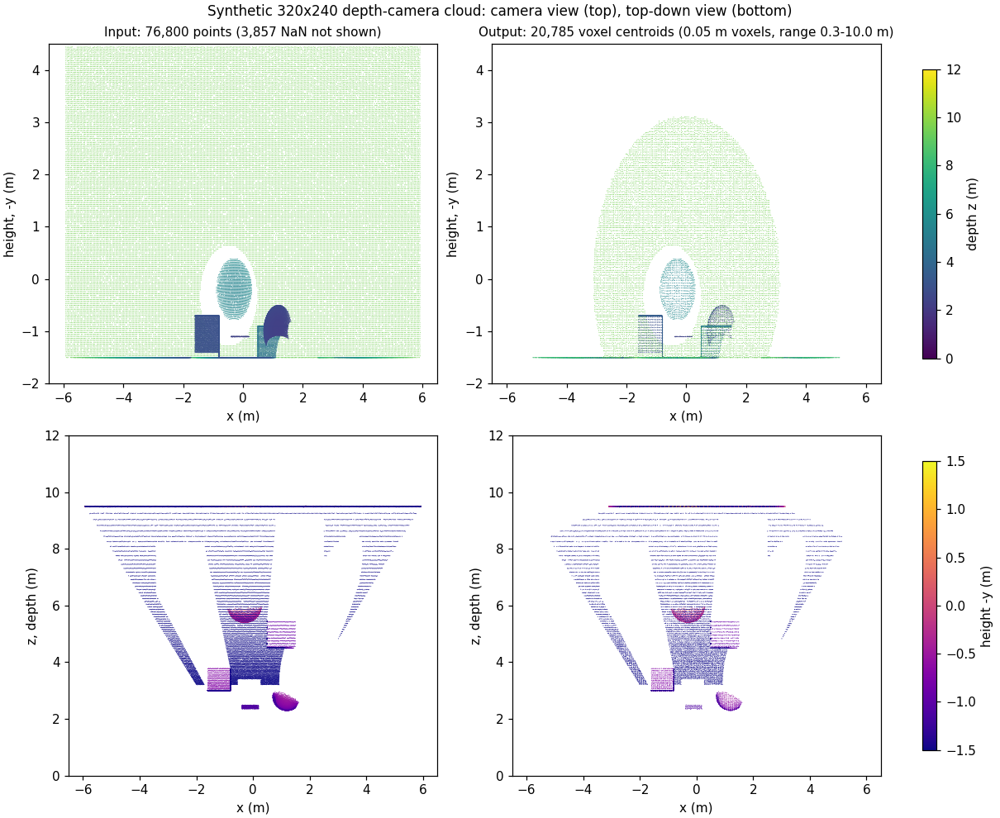
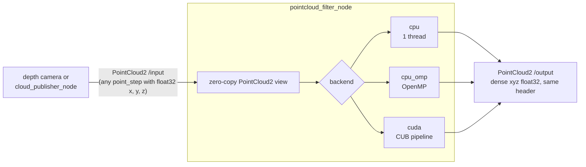

# ros2-gpu-pointcloud

[](https://github.com/Arsh624/ros2-gpu-pointcloud/actions/workflows/ci.yml)

A ROS 2 Jazzy node that range-filters and voxel-downsamples point clouds on the CPU (single-threaded or OpenMP) or on an NVIDIA GPU (CUDA + CUB), with the same output from every backend.
It comes with benchmarks of the bare filter and of the running node, measured on one laptop, with every number in this file taken from a committed file in [results/](results).



## At a glance

- **Inside the node at 1280x720 and 30 Hz, CUDA takes 3.48 ms per frame on 0.96 CPU cores; the fastest OpenMP setting takes 5.10 ms on 6.14 cores.** At 10 Hz the GPU clocks down between frames and CUDA rises to 11.07 ms. ([node_latency.csv](results/node_latency.csv))
- **Profiled, changed, measured again:** the host-to-device copy was the largest CUDA stage. Removing a staging copy cut the 1280x720 end-to-end time from 2.356 to 1.641 ms. ([stages.csv](results/stages.csv), [history](results/history))
- **The GPU's power management decides the result at camera rates:** after 100 ms of idle a 1280x720 CUDA call takes 6.96 ms instead of 1.49 ms. ([idle_gap.csv](results/idle_gap.csv))
- **In a tight loop CUDA beats the best CPU baseline (OpenMP, 20 threads) only at larger clouds:** 0.59x at 320x240, 1.30x at 640x480, 1.76x at 1280x720, end to end. ([bench.csv](results/bench.csv))
- **Throughput at 1280x720 (921,600 points):** CUDA filters 561 million input points/s end to end (2.12 billion/s GPU-only), against 64.7 million/s for single-threaded `pcl::VoxelGrid` (8.68x) and 319 million/s for OpenMP on 20 threads. ([bench.csv](results/bench.csv))
- **Across containers, Fast DDS with defaults dropped 37.4% of 3.7 MB clouds at 10 Hz; Zenoh dropped none** (p50 4.28 ms). Fast DDS's `LARGE_DATA` mode also delivered everything (p50 4.15 ms). Single host, Docker bridge network. ([net.csv](results/net.csv))
- **Parity:** every backend returns the same voxel count; centroids agree within 1e-4 m per axis (tested), and were identical on every tested cloud.

## How it works



Per point: drop non-finite points, keep `min_range <= |p| <= max_range`, compute the voxel `floor(coord / voxel_size)` per axis, and output one centroid per occupied voxel (summed in double), in ascending voxel-key order. Defaults: voxel 0.05 m, range 0.3 to 10 m.

The CUDA backend runs one stream with buffers allocated once and reused every frame:


Design decisions and the measurements behind them are in [docs/DESIGN.md](docs/DESIGN.md); the code layout is in [docs/ARCHITECTURE.md](docs/ARCHITECTURE.md).

## Quick start

Needs Docker with the NVIDIA container runtime and a CUDA GPU (the `cpu` and `cpu_omp` backends work without one). From the repository root (from Git Bash on Windows, run `export MSYS_NO_PATHCONV=1` first):

```bash
docker compose -f docker/compose.dev.yml up -d --build
```

```bash
docker exec gpc-dev /ros_entrypoint.sh bash -c 'cd /ws && colcon build --cmake-args -DWITH_PCL=ON && colcon test && colcon test-result --verbose'
```

Expect `81 tests, 0 errors, 0 failures, 1 skipped`. The skipped test checks the error path of a build without CUDA, so it only runs in such a build.

Run the node (backend `cpu`, `cpu_omp` or `cuda`), feed it the synthetic 640x480 cloud and print the output width, then stop it:

```bash
docker exec -d gpc-dev /ros_entrypoint.sh ros2 run gpu_pointcloud pointcloud_filter_node --ros-args -p backend:=cuda
```

```bash
docker exec gpc-dev /ros_entrypoint.sh bash -c 'ros2 run gpu_pointcloud cloud_publisher_node --ros-args -r cloud:=input -p count:=50 & ros2 topic echo --once /output sensor_msgs/msg/PointCloud2 --field width'
```

```bash
docker exec gpc-dev pkill -INT -f pointcloud_filter_node
```

All three backends print `34654`.

Benchmarks (each overwrites its files in `results/`; nothing else should run in the container meanwhile):

```bash
docker exec gpc-dev /ros_entrypoint.sh bash /ws/src/ros2-gpu-pointcloud/scripts/bench.sh
```

```bash
docker exec gpc-dev /ros_entrypoint.sh bash /ws/src/ros2-gpu-pointcloud/scripts/node_bench.sh
```

Network benchmark (runs on the host and starts its own containers from `docker/compose.net.yml`; the committed run also included the tuned Fast DDS configuration, about 28 minutes):

```bash
RMWS="rmw_fastrtps_cpp rmw_zenoh_cpp rmw_fastrtps_cpp+LARGE_DATA" bash scripts/net_bench.sh
```

The before/after plot (matplotlib on the host):

```bash
docker exec gpc-dev /ros_entrypoint.sh bash -c 'mkdir -p /ws/src/ros2-gpu-pointcloud/build_tmp && /ws/install/gpu_pointcloud/lib/gpu_pointcloud/bench_filter --backend cuda --res 320x240 --iters 1 --warmup 0 --dump /ws/src/ros2-gpu-pointcloud/build_tmp/cloud'
```

```bash
python3 scripts/plot_before_after.py build_tmp/cloud_320x240_input.xyz build_tmp/cloud_320x240_cuda.xyz results/before_after.png
```

## Results

Environment: NVIDIA GeForce RTX 4070 Laptop GPU (driver 616.64, CUDA 12.6), Intel Core i9-14900HX with 20 logical CPUs visible to the container, PCL 1.14.0, Fast DDS 2.14.7, rmw_zenoh_cpp 0.2.13, Docker on WSL2 (kernel 5.15.167.4), laptop on AC power. Synthetic depth-camera clouds: 320x240 (76,800 points), 640x480 (307,200) and 1280x720 (921,600), packed xyz (12 bytes per point).

### 1. Inside the ROS node: latency and CPU cost per frame

`scripts/node_bench.sh` runs `pointcloud_filter_node` against `cloud_publisher_node` in one container at 10 and 30 Hz and logs every callback ([results/node_latency.csv](results/node_latency.csv)). 100 messages at 10 Hz and 300 at 30 Hz per row, after 20 start-up messages; every message arrived. "Callback" is callback entry to the return of `publish()` (PointCloud2 view, filter, output message). "CPU" is the CPU time of the whole node process (all threads) during the callback.

| Backend | Resolution | 10 Hz callback p50 ms | 10 Hz p99 ms | 10 Hz CPU p50 ms | 10 Hz avg cores | 30 Hz callback p50 ms | 30 Hz p99 ms | 30 Hz CPU p50 ms | 30 Hz avg cores |
|---|---|---:|---:|---:|---:|---:|---:|---:|---:|
| cpu | 320x240 | 2.60 | 6.73 | 2.65 | 0.97 | 3.86 | 6.75 | 3.70 | 0.96 |
| cpu | 640x480 | 12.04 | 16.71 | 11.57 | 0.96 | 10.15 | 14.80 | 9.77 | 0.96 |
| cpu | 1280x720 | 27.47 | 32.99 | 26.42 | 0.96 | 27.09 | 34.63 | 26.06 | 0.97 |
| cpu_omp, 12 threads | 320x240 | 1.19 | 14.06 | 1.23 | 4.08 | 1.03 | 1.70 | 1.05 | 1.41 |
| cpu_omp, 12 threads | 640x480 | 4.03 | 11.54 | 4.47 | 4.53 | 2.34 | 9.76 | 2.31 | 2.59 |
| cpu_omp, 12 threads | 1280x720 | 6.46 | 18.22 | 10.35 | 4.17 | 6.68 | 10.99 | 29.57 | 4.55 |
| cpu_omp, 20 threads | 320x240 | 1.43 | 20.71 | 1.47 | 7.34 | 0.97 | 11.64 | 1.01 | 4.70 |
| cpu_omp, 20 threads | 640x480 | 3.06 | 49.53 | 3.46 | 8.13 | 1.84 | 11.42 | 2.12 | 3.83 |
| cpu_omp, 20 threads | 1280x720 | 7.17 | 19.18 | 65.21 | 9.03 | 5.10 | 11.21 | 11.76 | 6.14 |
| cuda | 320x240 | 2.67 | 4.56 | 2.56 | 0.97 | 1.83 | 4.45 | 1.77 | 0.97 |
| cuda | 640x480 | 2.90 | 6.99 | 2.79 | 0.97 | 2.50 | 7.13 | 2.41 | 0.97 |
| cuda | 1280x720 | 11.07 | 13.58 | 10.65 | 0.96 | 3.48 | 12.09 | 3.35 | 0.96 |

"Avg cores" is total CPU time over total callback time for the row; the CPU p50 column is the median of single callbacks, so the two do not divide into each other exactly.

- **CUDA costs one core, OpenMP costs four to nine.** At 1280x720 and 30 Hz, CUDA takes 3.48 ms per frame on 0.96 cores; OpenMP on 12 threads takes 6.68 ms on 4.55 cores, on 20 threads 5.10 ms on 6.14 cores. CUDA's CPU time equals its wall time, which fits the host thread spinning while it waits for the GPU (the CUDA runtime's default wait policy); a blocking wait was not tried.
- **At 30 Hz CUDA is the fastest at 1280x720.** At 640x480 OpenMP on 20 threads has the lower median (1.84 against 2.50 ms); CUDA has the lowest p99 at 640x480 at both rates (7.13 and 6.99 ms).
- **At 10 Hz the GPU's idle clock-down shows up again**: CUDA 1280x720 goes from 3.48 ms at 30 Hz to 11.07 ms at 10 Hz (section 3).
- **OpenMP tails are long inside a node.** Its p99 is between 10 and 50 ms in 10 of its 12 rows. The cause was not isolated; without ROS, section 3 shows single OpenMP calls of 20 to 70 ms after an idle gap.
- The single-threaded `cpu` backend needs 27 ms of the 33 ms frame budget at 1280x720 and 30 Hz.

**Middleware setting used here.** Transport is not what this measures, so both processes use Fast DDS over shared memory with a segment large enough for one cloud ([docker/fastdds_shm_large.xml](docker/fastdds_shm_large.xml), set by `compose.dev.yml`). With middleware defaults most clouds of 0.9 MB and more were dropped in this container: Fast DDS's default 512 KB shared-memory segment is smaller than one sample, and the UDP path is limited by the Docker VM's 208 KB socket buffer cap ([docs/DESIGN.md](docs/DESIGN.md), "Middleware for same-host node runs").

### 2. The input bottleneck: profiled, changed, measured again

The first per-stage breakdown (cudaEvents around every stage) showed that getting the cloud onto the GPU cost more than everything the GPU then did with it: 1.62 ms of 2.36 ms at 1280x720. The input path at that point was a `memcpy` into a pinned staging buffer followed by one asynchronous transfer.

What the measurements showed ([docs/DESIGN.md](docs/DESIGN.md), "Input path"):

- The host `memcpy` was 0.45 ms of the 1.62 ms.
- A transfer straight from the caller's ordinary (pageable) memory takes about as long as the transfer from pinned memory did, so the staging copy bought nothing here and could be removed.
- For 16-byte points, uploading the raw bytes and reading x, y, z by offset on the device beat gathering x, y, z on the host first at every size. For 32-byte points the host gather was faster at 320x240 and 640x480 and slightly slower at 1280x720.

So every backend now takes a strided view of the caller's buffer (the layout of a PointCloud2), and the CUDA backend uploads it without a staging copy: raw for points up to 16 bytes, host-gathered for wider ones.

| | 320x240 | 640x480 | 1280x720 |
|---|---:|---:|---:|
| Input stage before, ms | 0.127 | 0.517 | 1.618 |
| Input stage after, ms | 0.110 | 0.342 | 1.053 |
| CUDA end-to-end before, ms | 0.442 | 0.998 | 2.356 |
| CUDA end-to-end after, main run, ms | 0.415 | 0.705 | 1.641 |
| CUDA end-to-end after, median of 7 launches, ms | 0.489 | 0.733 | 1.666 |

In the slower launch state (below) the 1280x720 time, about 2.4 ms, is no better than before the change. The "before" numbers come from single launches whose state was not recorded, so the size of the improvement is only established for the faster state. The input transfer is still the largest stage (1.05 ms of 1.64 ms).

**The CUDA end-to-end time also depends on the process launch.** The same binary run seven times gave these medians ([results/cuda_launches.csv](results/cuda_launches.csv)):

| Resolution | Fastest launch ms | Median launch ms | Slowest launch ms | Speedup vs best CPU, slowest to fastest |
|---|---:|---:|---:|---:|
| 320x240 | 0.384 | 0.489 | 0.512 | 0.48x to 0.64x |
| 640x480 | 0.704 | 0.733 | 1.122 | 0.81x to 1.30x |
| 1280x720 | 1.504 | 1.666 | 2.423 | 1.19x to 1.92x |

At 1280x720 four launches were between 1.50 and 1.67 ms and three were near 2.4 ms. The difference is in the host-to-device transfer, which takes about 0.93 ms or about 1.74 ms for the same 11 MB. Host memory speed, CPU core type, buffer allocation and the bare transfer call were each ruled out by measurement; the cause was not found ([docs/DESIGN.md](docs/DESIGN.md), "Two transfer rates").

### 3. The idle GPU: why a frame rate changes the answer

A benchmark loop never lets the GPU rest. A camera does. `bench_idle_gap` sleeps before every call and times the call ([results/idle_gap.csv](results/idle_gap.csv)). Median ms per call:

| Idle gap before each call | cpu_omp 640x480 | cuda 640x480 | cpu_omp 1280x720 | cuda 1280x720 |
|---|---:|---:|---:|---:|
| none (tight loop) | 0.91 | 0.71 | 2.69 | 1.49 |
| 10 ms | 1.20 | 1.28 | 2.98 | 2.11 |
| 33 ms (30 Hz) | 1.37 | 1.94 | 3.21 | 3.03 |
| 100 ms (10 Hz) | 1.72 | 1.95 | 4.71 | 6.96 |
| 300 ms | 7.03 | 5.94 | 9.39 | 12.71 |
| 1 s | 6.74 | 6.05 | 7.33 | 13.00 |

The cause on the GPU side is its power management. `nvidia-smi` reports the idle GPU in performance state P8 at 210 MHz core / 405 MHz memory clock and 2 W; under the benchmark it is in P0 at 2625 MHz / 7000 to 8200 MHz and 33 W. After 3 s of idle it takes roughly a quarter to a third of a second of continuous work before calls are back to full speed ([results/idle_recovery.csv](results/idle_recovery.csv)). A tiny GPU call every 2 ms in the background does not prevent this ([results/idle_gap_keepalive.csv](results/idle_gap_keepalive.csv)): the clocks follow load, not activity. The CPU side slows because the OpenMP worker threads go to sleep; its worst single calls after a gap reached 20 to 70 ms.

The same effect explained an earlier CUDA p99 of 11 to 12 ms at 1280x720: per-iteration samples ([results/p99_tail_example.csv](results/p99_tail_example.csv)) showed these were the first few timed iterations after the GPU had idled while the CPU backends ran. The benchmark now warms up for at least 500 ms; without that 2 of 6 runs had slow timed iterations, with it 0 of 8.

So on this laptop **the GPU backend pays off when it is kept busy**: at high frame rates, with large clouds, or when several streams share it. A desktop or embedded GPU with different power management may behave differently; that has not been measured.

### 4. Back to back: speedup against the best CPU baseline

`bench_filter`, no ROS: median of 200 timed iterations after 20 warmup iterations and at least 500 ms ([results/bench.csv](results/bench.csv)). The best CPU baseline at every resolution is this repository's OpenMP backend on 20 threads.

| Resolution | Best CPU (OpenMP, 20 threads) ms | CUDA end-to-end ms | CUDA GPU-only ms | End-to-end speedup | GPU-only speedup |
|---|---:|---:|---:|---:|---:|
| 320x240 | 0.246 | 0.415 | 0.218 | 0.59x | 1.13x |
| 640x480 | 0.914 | 0.705 | 0.256 | 1.30x | 3.57x |
| 1280x720 | 2.889 | 1.641 | 0.435 | 1.76x | 6.64x |

All backends, median ms (99th percentile in brackets):

| Resolution | cpu (1 thread) | pcl (1 thread) | cpu_omp (20 threads) | cuda end-to-end | cuda GPU-only | Output points |
|---|---:|---:|---:|---:|---:|---:|
| 320x240 | 1.894 (2.174) | 1.603 (1.972) | 0.246 (0.490) | 0.415 (0.676) | 0.218 (0.376) | 20,785 |
| 640x480 | 8.732 (12.042) | 5.011 (6.015) | 0.914 (1.583) | 0.705 (0.815) | 0.256 (0.339) | 34,654 |
| 1280x720 | 26.156 (29.344) | 14.242 (17.667) | 2.889 (12.901) | 1.641 (1.917) | 0.435 (0.547) | 39,514 |

Against the single-threaded baselines CUDA end-to-end is 4.56x / 12.38x / 15.93x faster than `cpu` and 3.86x / 7.11x / 8.68x faster than PCL. Those are the easy comparisons; the OpenMP one above is the fair one.

Input throughput (input points / median time), million points per second:

| Resolution | cpu | pcl | cpu_omp | cuda end-to-end | cuda GPU-only |
|---|---:|---:|---:|---:|---:|
| 320x240 | 40.5 | 47.9 | 313 | 185 | 352 |
| 640x480 | 35.2 | 61.3 | 336 | 436 | 1,199 |
| 1280x720 | 35.2 | 64.7 | 319 | 561 | 2,120 |

- **cpu**: single-threaded reference: key every point, `std::sort`, linear reduce, `-O3`.
- **cpu_omp**: the same algorithm on OpenMP (parallel classify, sort and reduce), bit-identical output to `cpu`. 20 threads was the fastest setting at every resolution in the thread sweep ([results/cpu_omp_threads.csv](results/cpu_omp_threads.csv)).
- **pcl**: a radial range loop followed by `pcl::VoxelGrid`, single-threaded. Converting into and out of PCL point types is not timed, which favours PCL. Its voxel counts equal ours on all nine tested cases; its centroids are float-accumulated and not bit-compatible.
- **cuda end-to-end**: host input to host output, including both transfers and the final synchronisation, timed with `std::chrono::steady_clock`.
- **cuda GPU-only**: the device pipeline between the two transfers, timed with cudaEvents.

Earlier runs are kept in [results/history](results/history). CUDA end-to-end median ms:

| Run | What changed | 320x240 | 640x480 | 1280x720 |
|---|---|---:|---:|---:|
| [m4](results/history/m4) | First benchmark | 0.461 | 1.049 | 2.439 |
| [a-baselines](results/history/a-baselines) | OpenMP and PCL baselines added; no change to the CUDA code | 0.442 | 0.998 | 2.356 |
| [b-input-path](results/history/b-input-path) | Direct upload of the input buffer, fields read on the device | 0.430 | 0.792 | 1.702 |
| current | Warmup of at least 500 ms; no change to the CUDA code | 0.415 | 0.705 | 1.641 |

The first benchmark reported 3.96x, 7.55x and 10.53x. Those were against the single-threaded backend, the only baseline at the time, in a tight loop.

### 5. Networking: Fast DDS against Zenoh across containers

`scripts/net_bench.sh` publishes the 640x480 cloud from one container and receives it in another, on one Docker bridge network, with a Zenoh router in a third container ([results/net.csv](results/net.csv)). Separate containers have separate network and IPC namespaces, so neither middleware can use shared memory. Both ends read the host's clock, so latency is `now - header.stamp` at the listener with no clock-sync error. 2020 messages per row; the first 20 are counted but left out of the latency statistics. Latency columns cover delivered messages only. Payloads: the raw cloud (3,686,400 bytes) and the same cloud after the default filter (34,654 points, 415,848 bytes). Fast DDS 2.14.7, rmw_zenoh_cpp 0.2.13.

| Middleware | Payload | Rate Hz | Sent | Received | Dropped | p50 ms | p99 ms | max ms | MB/s received |
|---|---|---:|---:|---:|---:|---:|---:|---:|---:|
| Fast DDS, defaults | raw, 3.69 MB | 10 | 2020 | 1265 | 37.4% | 6.400 | 9.729 | 10.206 | 23.11 |
| Fast DDS, defaults | raw, 3.69 MB | 30 | 2020 | 1363 | 32.5% | 4.496 | 8.751 | 9.965 | 74.91 |
| Fast DDS, defaults | filtered, 0.42 MB | 10 | 2020 | 1751 | 13.3% | 1.104 | 1.938 | 2.708 | 3.61 |
| Fast DDS, defaults | filtered, 0.42 MB | 30 | 2020 | 1518 | 24.9% | 0.689 | 1.516 | 2.037 | 9.41 |
| Zenoh, defaults | raw, 3.69 MB | 10 | 2020 | 2020 | 0.0% | 4.283 | 7.863 | 8.591 | 36.86 |
| Zenoh, defaults | raw, 3.69 MB | 30 | 2020 | 2020 | 0.0% | 4.002 | 7.101 | 8.078 | 110.59 |
| Zenoh, defaults | filtered, 0.42 MB | 10 | 2020 | 2020 | 0.0% | 0.873 | 1.951 | 2.288 | 4.16 |
| Zenoh, defaults | filtered, 0.42 MB | 30 | 2020 | 2020 | 0.0% | 0.919 | 1.896 | 2.476 | 12.48 |
| Fast DDS, LARGE_DATA (tuned) | raw, 3.69 MB | 10 | 2020 | 2020 | 0.0% | 4.154 | 7.984 | 10.345 | 36.86 |
| Fast DDS, LARGE_DATA (tuned) | raw, 3.69 MB | 30 | 2020 | 2020 | 0.0% | 4.136 | 7.174 | 7.844 | 110.59 |
| Fast DDS, LARGE_DATA (tuned) | filtered, 0.42 MB | 10 | 2020 | 2020 | 0.0% | 0.899 | 1.987 | 2.335 | 4.16 |
| Fast DDS, LARGE_DATA (tuned) | filtered, 0.42 MB | 30 | 2020 | 2020 | 0.0% | 0.897 | 1.958 | 2.279 | 12.48 |

- **With defaults, Fast DDS loses a third of the raw clouds** (37.4% at 10 Hz, 32.5% at 30 Hz) and 13 to 25% of the filtered ones. Zenoh, also with defaults (only the router address and a non-loopback listen endpoint set), delivered every message.
- **Where both deliver everything, they are level**: raw cloud p50 4.28 / 4.00 ms on Zenoh against 4.15 / 4.14 ms on Fast DDS with `LARGE_DATA`, at 10 / 30 Hz. Filtering before sending cuts the latency to under 1 ms and the bandwidth by 8.9x.
- **The one tuned configuration** is Fast DDS's built-in `LARGE_DATA` mode (`FASTDDS_BUILTIN_TRANSPORTS=LARGE_DATA`, data over TCP). It was added only because the defaults dropped messages. The UDP losses fit the Docker VM's 208 KB socket buffer cap (`net.core.rmem_max`), which was left alone.
- The Fast DDS default rows' lower latencies at 30 Hz (filtered 0.689 ms) cover only the messages that arrived, so they do not mean Fast DDS was faster.
- **Single host, Docker bridge network: not a real LAN.** A two-machine test is future work.

### 6. Parity

CPU, OpenMP and CUDA must return the same voxel count exactly and every centroid within **1e-4 m per axis**. `test_parity_cuda` checks this on all three resolutions with voxel sizes 0.02, 0.05 and 0.1 m, plus the edge cases (NaN and Inf, exact range boundaries, negative coordinates on voxel boundaries, index overflow, a cloud larger than the reserved buffers). The measured difference was 0 m on every tested cloud: both compilers have floating-point contraction disabled so voxel keys match bit for bit, and sums are in double.

## Limitations

- **Synthetic data only.** A real sensor will have a different ratio of input points to occupied voxels, and so different timings.
- **One laptop GPU under WSL2.** RTX 4070 Laptop, Docker on WSL2; a desktop, embedded or native-Linux GPU may behave differently.
- **The GPU slows down after idle**, so results at 10 Hz differ a lot from tight-loop results (section 3). Windows' "prefer maximum performance" GPU mode was not tried.
- **Two host-to-device transfer rates per filter instance** (about 0.93 or 1.74 ms for 11 MB), cause unknown.
- **compute-sanitizer was not run**: it cannot attach to the GPU under WSL2 without an administrator change on Windows ([#3](https://github.com/Arsh624/ros2-gpu-pointcloud/issues/3)).
- **The Nsight Systems capture has no GPU kernel rows under WSL2**; per-stage times come from cudaEvents instead ([results/nsys_summary.txt](results/nsys_summary.txt) has host-side ranges only).
- **The raw-versus-repack rule for wide points is provisional**: measured only for 16- and 32-byte points.
- **The maximum sustainable input rate per backend was not measured** (`RATE_SWEEP=1 scripts/node_bench.sh` exists but was not run).
- **Node results use a tuned middleware profile** (Fast DDS shared memory, 16 MB segment). With defaults, large clouds are mostly dropped in this container.
- **The CUDA backend's host thread spins while waiting** (one full core per frame in the node); a blocking wait was not tried.
- **The OpenMP backend's long tails inside the node were not explained.**
- **The PCL baseline does not time its point-type conversions**, which favours PCL.
- **Networking was measured on one host**, between containers on a Docker bridge network, not over a real LAN; a two-machine test is future work ([#19](https://github.com/Arsh624/ros2-gpu-pointcloud/issues/19)). Only one Fast DDS tuning (`LARGE_DATA`) and no Zenoh tuning was tried.

## Tests and CI

CI builds and tests the CPU paths in `ros:jazzy-ros-base` and compiles the CUDA core library in the CUDA devel image. GitHub runners have no GPU, so the CUDA parity tests run only locally (they skip themselves when no GPU is visible). The PCL comparison test is built only with `-DWITH_PCL=ON`, which CI does not use.

## License

MIT, see [LICENSE](LICENSE).
